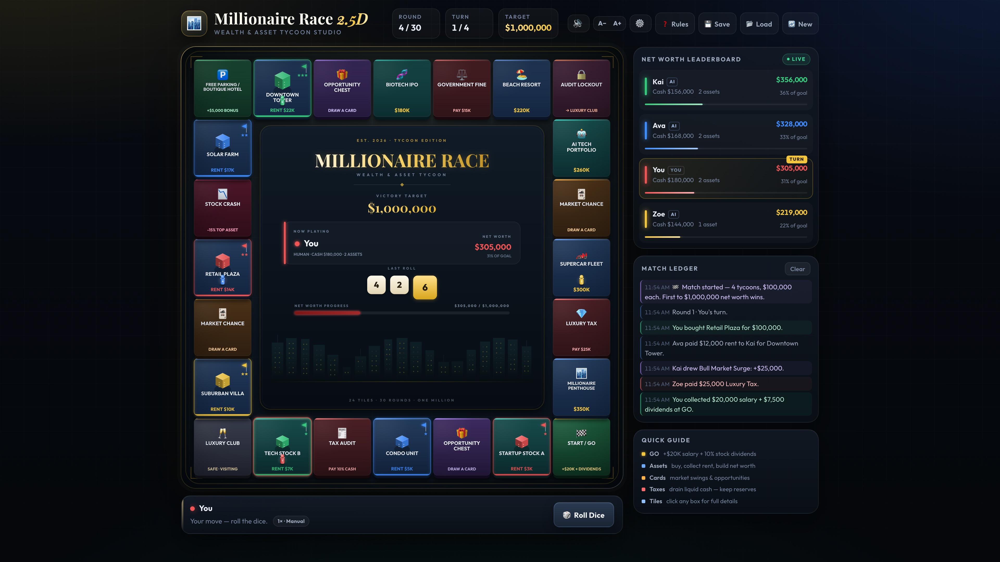
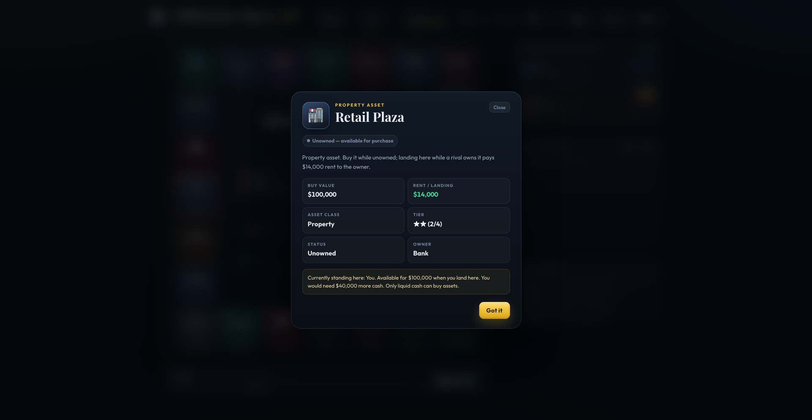
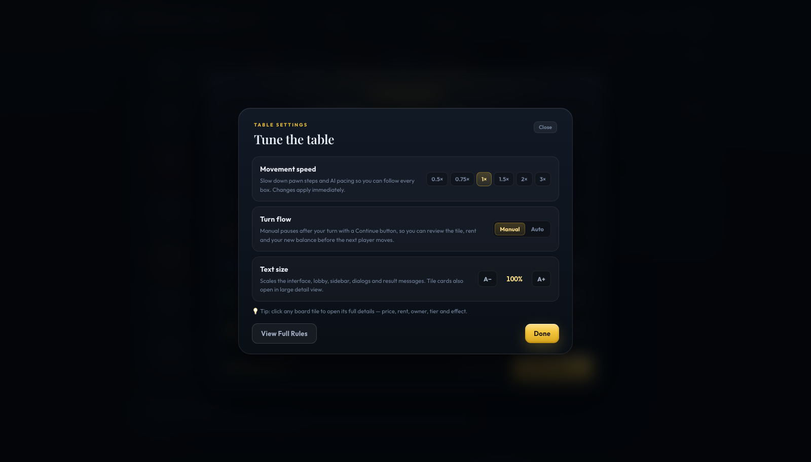
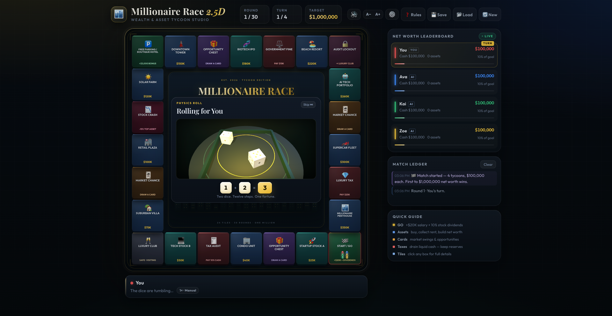
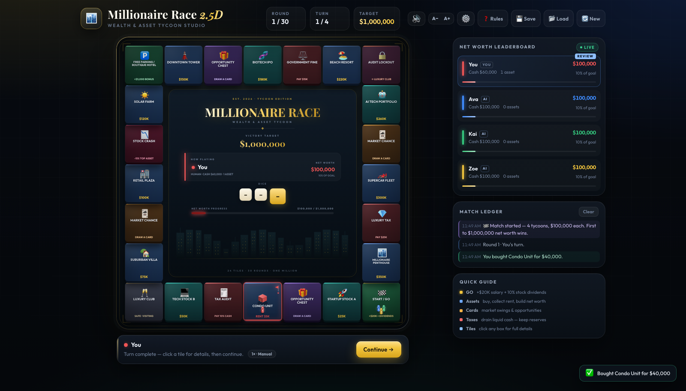
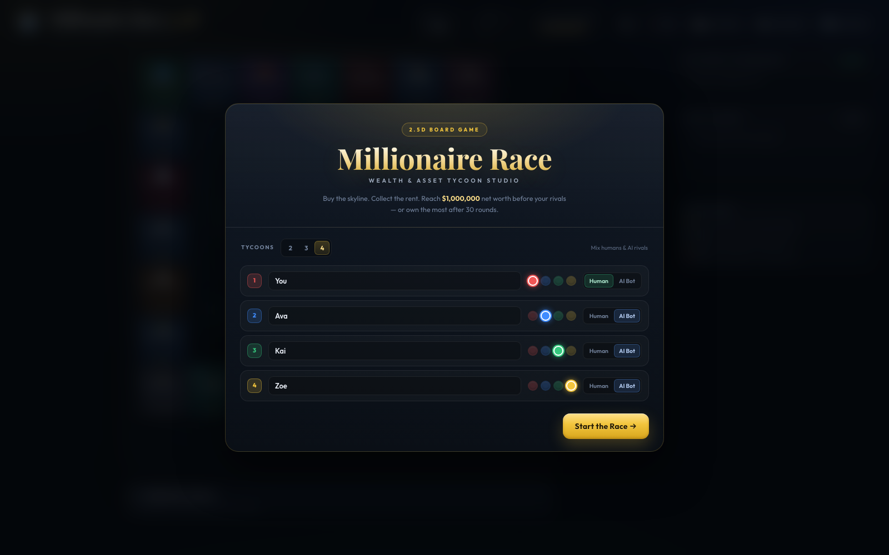

# Millionaire Race 2.5D

### Wealth & Asset Tycoon Studio

A complete, production-ready 2.5D wealth-building board game for the browser. Buy the skyline, collect rent, outplay AI tycoons, and be the first to a **$1,000,000** net worth.



<p align="center">
  
  
  
</p>

<p align="center">
  
  
</p>

---

## Play

No build step. No dependencies to install.

```bash
cd millionaire-race-2.5d
python3 -m http.server 8080
# open http://localhost:8080
```

You can also open `index.html` directly, but a local server is recommended so browser storage works consistently.

The board, economy, AI and persistence are fully offline-capable. The 3D dice use **Three.js + Cannon.js** from a CDN; if those scripts are blocked, the game automatically uses a Canvas 2D dice fallback. Google Fonts are progressive enhancement — the game falls back to system fonts.

---

## Highlights

- **2–4 player lobby** with editable names, red/blue/green/yellow color pickers and Human / AI Bot toggles.
- **Top-down 2.5D Canvas board** — extruded tiles, isometric property towers, ownership flags, asset-tier stars, live pawns with hop animation, glowing current-tile ring and an animated city skyline.
- **Review-friendly pacing** — movement speed from **0.5× to 3×**, plus **Manual / Auto turn flow**. Manual pauses after your turn with a **Continue** button so you can study the tile, rent and balance before advancing.
- **Tile inspector** — click or tap **any board box** for a large detail card with price, rent/yield, owner, tier, mortgage status, live position info and dynamic effect notes.
- **Readable interface** — **A− / A+ text scaling** (100%, 110%, 125%, 140%) for the lobby, sidebar, dialogs, logs and board labels, persisted between sessions.
- **Real 3D physics dice** — two tumbling Cannon.js cubes inside a Three.js table, random forces and torque, pip textures, shadows, rail collisions, automatic rest detection and result reading from the upward face. The roll shows in a **compact floating tray over the board centre**, with a light backdrop so the tiles stay visible; on phones the tray drops below the board.
- **Complete economy** — salaries, stock dividends, rent, taxes, auto-mortgages, bankruptcy, eliminations and a live net-worth leaderboard.
- **Shuffled card deck** — bull runs, crypto crashes, real-estate booms and tax loopholes.
- **AI decision tree** — bots buy when reserves stay above $20,000 and pay the $10,000 audit-lockout exit fee when cash is above $30,000.
- **Win conditions** — instant victory at $1,000,000 net worth at the end of a turn; otherwise the highest net worth after 30 rounds.
- **Persistence** — autosave after every turn to `localStorage`, plus JSON export (`millionaire_race_save.json`) and import.
- **Synthesized audio** — Web Audio dice rumbles/impacts, coin chimes, pawn thuds, card shuffles, purchase arpeggios, bankruptcy stings and a win fanfare.
- **Responsive & accessible** — mobile layout, keyboard controls (`R` to roll, `Space` to continue after review, `Esc` to close dialogs), reduced-motion support, labelled dialogs and live logs.

---

## How to win

| Rule | Detail |
| --- | --- |
| **Instant victory** | First player to reach **$1,000,000 total net worth** at the end of a turn wins. |
| **Round-limit victory** | If nobody reaches $1M, the highest net worth after **30 rounds** wins. |
| **Net worth** | Cash + the buy value of every asset you own. |
| **Start** | $100,000 cash and $100,000 net worth per player. |
| **GO** | Passing or landing on GO pays **$20,000 salary + 10% dividends** on the buy value of owned stocks. |
| **Rent** | Landing on a rival's asset pays rent/yield to the owner. |
| **Mortgage** | If cash is short, assets auto-mortgage at **50%** of purchase value. |
| **Bankruptcy** | A player who cannot cover a debt and has no assets left is eliminated; their assets return to the bank. |
| **Lockout** | Tile 18 sends you to the Luxury Club and costs your next turn unless you pay the **$10,000** exit fee. |

### AI decision tree

- **Buy:** only if `cash − price > $20,000`.
- **Lockout:** pay the $10,000 fee immediately if `cash > $30,000`; otherwise lose the turn.

---

## Table settings, review & inspection

Open **⚙️ Table Settings** (or click the `1× · Manual` chip in the dock) to tune the table at any safe point.

| Setting | Options | Effect |
| --- | --- | --- |
| **Movement speed** | 0.5× · 0.75× · 1× · 1.5× · 2× · 3× | Scales pawn hop duration, the after-GO pause, AI thinking/action delays and the review delay. |
| **Turn flow** | **Manual** (default) · Auto | Manual pauses after each **human** turn with a Continue button. AI turns keep playing so you can watch the table. Auto restores the original uninterrupted flow. |
| **Text size** | **100% · 110% · 125% · 140%** | Scales the lobby, tabs, sidebar, log, dialogs and result messages. Header action labels collapse to icons at 125%+ to keep one row. Board labels also get a readable boost. |

**Manual review:** the player's leaderboard row shows **REVIEW**, the dock shows **Continue →**, and the state is autosaved. Press **Space/Enter** or click Continue when you are ready. The next player then begins.

**Tile inspector:** click or tap any board box in a safe phase — before rolling, while deciding to buy, during a lockout choice, during review, or after the match. It opens a large card with:

- buy value, rent / yield, asset class, tier stars and owner;
- active / mortgaged / unowned status;
- dynamic notes such as cash shortfall, crash exposure, the current tax bill and who is standing there.

During dice motion or pawn movement the inspector asks you to wait, then opens normally.

Text size, speed and turn flow are saved in `localStorage`, so your reading preference and pacing survive reloads.

---

## Board map (24 tiles)

| # | Tile | Price | Rent / Effect |
| ---: | --- | ---: | --- |
| 0 | START / GO | — | +$20,000 salary + 10% stock dividends |
| 1 | Startup Stock A | $25,000 | $3,000 yield |
| 2 | Opportunity Chest | — | Draw a card |
| 3 | Condo Unit | $40,000 | $5,000 rent |
| 4 | Tax Audit | — | Pay 10% of liquid cash |
| 5 | Tech Stock B | $50,000 | $7,000 yield |
| 6 | LUXURY CLUB | — | Just visiting / safe zone |
| 7 | Suburban Villa | $75,000 | $10,000 rent |
| 8 | Market Chance | — | Draw a card |
| 9 | Retail Plaza | $100,000 | $14,000 rent |
| 10 | Stock Crash | — | Lose 15% of your most expensive asset's value |
| 11 | Solar Farm | $120,000 | $17,000 yield |
| 12 | FREE PARKING / BOUTIQUE HOTEL | — | +$5,000 bonus |
| 13 | Downtown Tower | $150,000 | $22,000 rent |
| 14 | Opportunity Chest | — | Draw a card |
| 15 | Biotech IPO | $180,000 | $28,000 yield |
| 16 | Government Fine | — | Pay $15,000 |
| 17 | Beach Resort | $220,000 | $35,000 rent |
| 18 | AUDIT LOCKOUT | — | Go to tile 6; lose next turn unless you pay $10,000 |
| 19 | AI Tech Portfolio | $260,000 | $42,000 yield |
| 20 | Market Chance | — | Draw a card |
| 21 | Supercar Fleet | $300,000 | $50,000 rent |
| 22 | Luxury Tax | — | Pay $25,000 |
| 23 | Millionaire Penthouse | $350,000 | $65,000 rent |

### Card deck

- **Bull Market Surge** — +$25,000 investment bonus.
- **Cryptocurrency Crash** — −$15,000 trading loss.
- **Real Estate Boom** — collect $5,000 from every rival.
- **Tax Loophole Found** — your next tax tile costs $0.

Each deck is Fisher–Yates shuffled and refilled when exhausted.

---

## Controls

| Action | How |
| --- | --- |
| Roll | Click **🎲 Roll Dice** or press **R** |
| Buy / Pass | Decision buttons appear in the dock |
| Lockout | **Pay $10,000** to play, or **Lose Turn** |
| Review / continue | In **Manual** mode click **Continue →**, or press **Space / Enter** |
| Table settings | Click **⚙️** in the header or the **`1× · Manual`** chip in the dock |
| Inspect a box | Click or tap any board tile |
| Text size | **A− / A+** in the header, or the slider in Table Settings |
| Save / load | **💾 Save** / **📂 Load** in the header |
| New match | **🔄 New** |
| Sound | Speaker button |
| Close dialog | **Esc** |

Turns with no decision (rent, tax, cards, GO, parking) settle automatically. In **Manual** mode they then pause at the review step for a human player, so you can read the tile card and ledger before pressing Continue. AI turns keep moving automatically at the chosen speed.

---

## Tech

| Layer | Choice |
| --- | --- |
| Markup | Semantic HTML5 |
| Styling | Modern CSS3: custom properties, grid/flex, `backdrop-filter`, `color-mix`, responsive breakpoints, reduced-motion support |
| Logic | Vanilla ES6 JavaScript — no frameworks, no bundler |
| Board | HTML5 Canvas 2D at 1000×1000 logical resolution, DPR-aware, redrawn at 10 fps idle / 60 fps while animating |
| Inspection | Canvas hit-testing + hover outline, per-tile data model, dynamic detail cards |
| Pacing | Speed-scaled step/AI timers and a persisted Manual/Auto turn-flow state machine |
| Typography | rem-based UI scale (100–140%) plus a proportional Canvas label boost |
| Dice | Three.js r152 + Cannon.js 0.6.2 (CDN) with a Canvas 2D fallback |
| Audio | Web Audio API oscillators, filtered noise buffers and gain envelopes |
| Persistence | `localStorage` + JSON Blob import/export |

### Project structure

```
millionaire-race-2.5d/
├── index.html            # App shell, lobby, dice/card/win/rules dialogs
├── style.css             # Luxury fintech / board-game visual system
├── script.js             # Game engine, Canvas renderer, dice physics, audio, AI
├── screenshot-board.jpg
├── screenshot-dice.png
├── screenshot-lobby.png
├── screenshot-review.png
├── screenshot-settings.png
├── screenshot-tile.png
├── BUILD_STATE.md        # Build duration, token accounting and credits
├── build-state.json
├── LICENSE
└── README.md
```

### Try the demo

Append `?demo=1` to the URL to auto-start a four-player AI match. Add `&fast=1` to pre-populate a lived-in board with assets, cash and a mid-game round. These hooks are handy for screenshots and smoke tests.

---

## Validation performed

- JavaScript parsed with JavaScriptCore (`new Function(source)` syntax check).
- Headless Chrome render tests at 1920×1080, 1440×900 and 390×844, with no console errors.
- 3D dice verified under SwiftShader WebGL: physics settles, the top faces are read, and the result matches the dice chips.
- Canvas 2D dice fallback verified with WebGL disabled.
- Full **120-turn / 30-round** simulated match with random dice, cards, lockouts, purchases and rent — ended correctly on the 30-round net-worth tiebreak with no console errors.
- Targeted assertions for auto-mortgage, bankruptcy asset release, GO dividends, tax loophole, $1M victory, AI buy threshold and save/load round-trip.
- **Compact dice tray:** the board remains visible around the tray; on desktop the tray is centred over the board centre and on mobile it is anchored below the board.
- **Pacing & inspection checks:** 0.5× step measured at ~421 ms vs ~124 ms at 2×; Manual mode enters review with the Continue button and REVIEW badge; Auto mode advances to the AI seat; a real canvas click opens the correct tile card; review state survives save/load.
- **Text scaling checks:** 110% keeps the header on one row; 125% and 140% collapse header action labels to icons while keeping one row; log text scales from 11.5 px to 16.1 px at 140%.

---

## Build telemetry & credits

This entire project — design, code, copy, tests and screenshots — was created end-to-end by **[OpenCode](https://opencode.ai)** using **DeepSeek V4.1 Flash** (`opencode-go/deepseek-v4.1-flash`).

- **Wall-clock build time:** **98 min 18 sec** through the v1.1 review/readability update (first playable delivery at 48 min 25 sec), plus a compact-dice-tray tweak in a later sitting. See [BUILD_STATE.md](BUILD_STATE.md).
- **Token accounting:** **89,163,191** total at the latest snapshot — 1,506,897 input, 142,708 output, 249,664 reasoning, 87,262,080 cache read, 1,842 cache write. Cache reads dominate because the full context is re-read each turn. See [build-state.json](build-state.json).
- **Model / provider:** `opencode-go` · `deepseek-v4.1-flash`
- **Session:** `ses_e67a68f85ffe5oCsIETmyBfVZY`

Third-party assets: [Three.js](https://threejs.org), [Cannon.js](https://schteppe.github.io/cannon.js/), [Google Fonts](https://fonts.google.com) (Outfit, Playfair Display) and system emoji glyphs. No paid assets or image files were used for the game art — the board is drawn procedurally.

---

## License

MIT © 2026 Somphol Boonjing. See [LICENSE](LICENSE).
